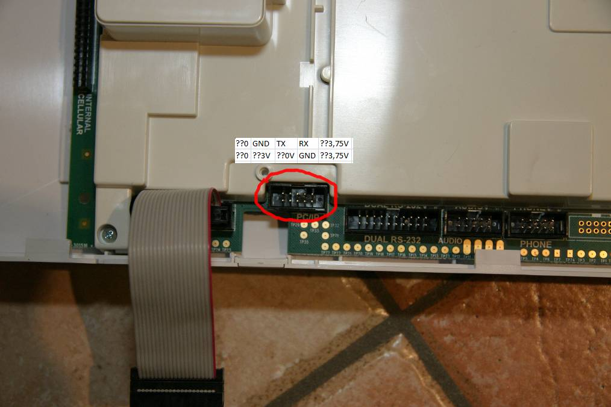
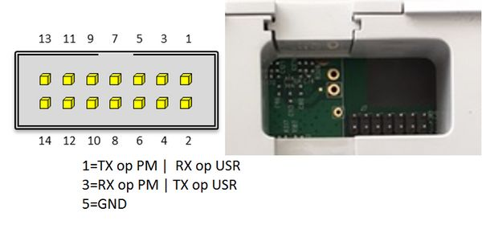

> **Language / Idioma:** [Read in English](https://github.com/ShaneGooseman/visonic/wiki/Hardware-Setup) | **Español**

# Configuración de hardware

Puedes conectar tu panel de alarma Visonic mediante **RS-232**, **USB** o **Ethernet** (cableado o Wi-Fi).

### Guías específicas de hardware
- [USR-WIFI232-D2, USR-TCP232-T2, USR-TCP232-E o USR-TCP232-E2](https://github.com/ShaneGooseman/visonic/wiki/USR-WIFI232-D2-ES)
- [NodeMCU con PowerMax Pro (`esp-link`)](https://github.com/ShaneGooseman/visonic/wiki/Using-NodeMCU-PowermaxProModel6-ES)
- [Wemos D1 R2 y ESPHome (con disparo de sirena)](https://github.com/ShaneGooseman/visonic/wiki/Using-Wemos-and-ESPHome-ES)
- [M5Stack ESP32 Ethernet con PoE (`M5Unit-PoESP32`) y ESPHome](https://github.com/ShaneGooseman/visonic/wiki/Using-M5Stack-ESP32-Ethernet-Unit-with-POE-M5Unit-PoESP32-ES)

> **Plantillas ESPHome:** Las plantillas YAML actualizadas para ESP32, M5Stack PoESP32 y Wemos D1 R2 se mantienen directamente en [`custom_components/visonic/examples/esphome/`](https://github.com/ShaneGooseman/visonic/tree/master/custom_components/visonic/examples/esphome).

## Conector interno del panel
Los paneles PowerMax y PowerMaster disponen de un conector interno de 10 pines etiquetado como Control, PC/IP o RS232 que trabaja con niveles lógicos TTL.



_Crédito de imagen: [viknet en domoticaforum.eu](https://www.domoticaforum.eu/viewtopic.php?f=68&t=7152&start=0)_

Algunos modelos antiguos de PowerMax+ pueden tener un conector de 14 pines:



_Crédito de imagen: luccie_007 en el foro Athom_

Muchos paneles incluyen también un conector de 20 pines **Dual RS-232**; consulta [Notas técnicas del panel](https://github.com/ShaneGooseman/visonic/wiki/Panel-Stuff-ES) para el patillaje.

## ¿Necesito un módulo PowerLink 2/3/3.1?
- **No** para uso local independiente: esta integración emula PowerLink directamente.
- **Si ya tienes un PowerLink 3.1** y quieres seguir usando la app móvil de Visonic junto con Home Assistant, puedes ejecutar [`visonic_proxy`](https://github.com/msp1974/visonic_proxy) y conectar esta integración al proxy por Ethernet (autodescubrimiento por Zeroconf o configuración manual en modo `Powerlink (Puenteado)`).

## ¿Necesito el kit adaptador RS-232 de Visonic?
- Solo si conectas a un puerto serie clásico DB9 de ±12 V.
- **No es necesario** si usas adaptadores con niveles TTL (USB-a-TTL, Wemos/ESP32, USR-TCP232-E2/T2, USR-WIFI232-D2).

## Opciones de conexión

### Opción USB
Usa un adaptador serie USB-a-TTL (sin kit RS-232 de Visonic). En Linux/Raspberry Pi puedes verificar los parámetros del puerto con:
```bash
stty -F /dev/ttyUSB0 -a
stty -F /dev/ttyUSB0 9600 cs8 -parenb -cstopb
```

### Opciones Ethernet
1. **Linux / Raspberry Pi + `ser2net`:**
   ```
   10628:raw:600:/dev/serial/by-id/usb-FTDI_FT232R_USB_UART_A700eRHw-if00-port0:9600 8DATABITS NONE 1STOPBIT
   ```
2. **Puente dedicado Serie-a-Ethernet / Wi-Fi:** por ejemplo USR-TCP232-T2/E2, USR-WIFI232-D2, iTach IP2SL o NodeMCU con `esp-link` (configurado como servidor TCP transparente en un puerto > 1024).
3. **Puente serie con ESPHome:** Flashea un ESP32, M5Stack PoESP32 o Wemos D1 R2 con las plantillas de `custom_components/visonic/examples/esphome/`.

## Cableado y niveles lógicos TTL
Conecta **4 cables** (o 3 si usas alimentación externa/PoE, manteniendo **GND** común):
- `3.75V` del panel → `3.3V` del dispositivo (solo si alimentas desde el panel; en paneles con solo 5V usa regulador de 3.3V y conversor de niveles)
- `GND` del panel → `GND` del dispositivo
- `TX` del panel → `RX` del dispositivo
- `RX` del panel → `TX` del dispositivo

Niveles lógicos TTL:
- **PowerMax:** 0 V (lógico 0) / 5.0 V (lógico 1)
- **PowerMaster:** 0 V (lógico 0) / 3.3 V (lógico 1)

## Parámetros RS-232 y velocidad en baudios
Configura siempre **8 bits de datos, sin paridad, 1 bit de parada (8N1)** y sin control de flujo (CTS/RTS desactivado):
- Firmware **≤ 17.133:** `9600` baudios
- Firmware **≥ 18.xxx:** `38400` baudios *(algunos paneles 18.040 tempranos pueden usar `9600`; prueba ambas velocidades si no recibes datos)*
