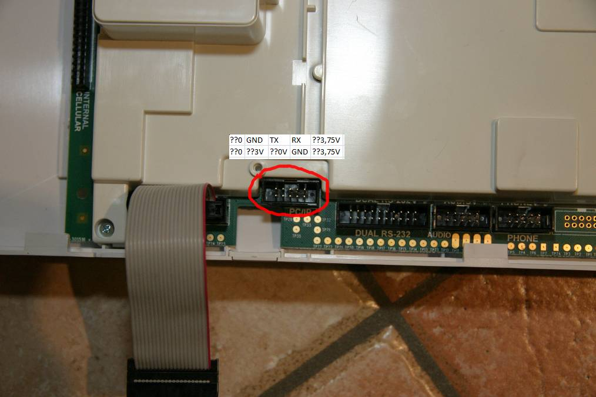
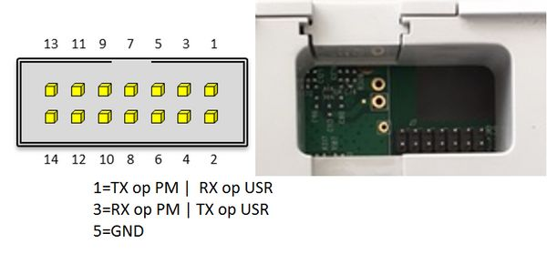

> **Language / Idioma:** **English** | [Leer en Español](https://github.com/ShaneGooseman/visonic/wiki/Hardware-Setup-ES)

# Hardware Setup

You can connect to your Visonic Alarm Panel using **RS-232**, **USB**, or **Ethernet** (Wired or Wi-Fi).

### Hardware Setup Guides
- [USR-WIFI232-D2, USR-TCP232-T2, USR-TCP232-E or USR-TCP232-E2](https://github.com/ShaneGooseman/visonic/wiki/USR-WIFI232-D2)
- [NodeMCU with PowerMax Pro (`esp-link`)](https://github.com/ShaneGooseman/visonic/wiki/Using-NodeMCU-PowermaxProModel6)
- [Wemos D1 R2 and ESPHome (including Siren Triggering)](https://github.com/ShaneGooseman/visonic/wiki/Using-Wemos-and-ESPHome)
- [M5Stack ESP32 Ethernet Unit with PoE (`M5Unit-PoESP32`) and ESPHome](https://github.com/ShaneGooseman/visonic/wiki/Using-M5Stack-ESP32-Ethernet-Unit-with-POE-M5Unit-PoESP32)

> **ESPHome Templates:** Ready-to-use ESPHome YAML templates for ESP32, M5Stack PoESP32, and Wemos D1 R2 are maintained directly in [`custom_components/visonic/examples/esphome/`](https://github.com/ShaneGooseman/visonic/tree/master/custom_components/visonic/examples/esphome).

## Internal Panel Connector
PowerMax/PowerMaster alarm panels provide an internal 10-pin connector labelled Control, PC/IP, or RS232, which uses TTL logic levels.



_Image credit: [viknet from domoticaforum.eu](https://www.domoticaforum.eu/viewtopic.php?f=68&t=7152&start=0)_

Older PowerMax+ panels may have a 14-pin connector instead:



_Image credit: luccie_007 from Athom forum_

Many panels also include a 20-pin **Dual RS-232** connector; see [Panel Stuff](https://github.com/ShaneGooseman/visonic/wiki/Panel-Stuff) for pinout notes.

## Do I need a PowerLink 2/3/3.1 Module?
- **No** for standalone local use: this integration emulates PowerLink directly.
- **If you already own a PowerLink 3.1** and want to keep using the Visonic mobile app alongside Home Assistant, you can run [`visonic_proxy`](https://github.com/msp1974/visonic_proxy) and connect this integration to the proxy over Ethernet (auto-discovered via Zeroconf or configured manually as `Powerlink (Bridged)`).

## Do I need the Visonic RS-232 Adapter Kit?
- Only if connecting to a legacy ±12 V DB9 RS-232 port.
- **Not needed** when using TTL-level adapters (USB-to-TTL, Wemos/ESP32, USR-TCP232-E2/T2, USR-WIFI232-D2).

## Connection Options

### USB Option
Use a USB-to-TTL serial adapter (no Visonic RS-232 Adapter Kit required). On Linux/Raspberry Pi you can verify serial port parameters with:
```bash
stty -F /dev/ttyUSB0 -a
stty -F /dev/ttyUSB0 9600 cs8 -parenb -cstopb
```

### Ethernet Options
1. **Linux / Raspberry Pi + `ser2net`:**
   ```
   10628:raw:600:/dev/serial/by-id/usb-FTDI_FT232R_USB_UART_A700eRHw-if00-port0:9600 8DATABITS NONE 1STOPBIT
   ```
2. **Dedicated Serial-to-Ethernet / Wi-Fi bridge:** e.g., USR-TCP232-T2/E2, USR-WIFI232-D2, iTach IP2SL, or NodeMCU with `esp-link` (configured as a transparent TCP server on a port > 1024).
3. **ESPHome Serial Bridge:** Flash an ESP32, M5Stack PoESP32, or Wemos D1 R2 using the YAML templates in `custom_components/visonic/examples/esphome/`.

## Wiring & TTL Logic Levels
Connect **4 wires** (or 3 wires if powered externally/PoE, keeping **GND** shared):
- Panel `3.75V` → Device `3.3V` (only if powering from the panel; for 5V-only panels use a 3.3V regulator and level shifter)
- Panel `GND` → Device `GND`
- Panel `TX` → Device `RX`
- Panel `RX` → Device `TX`

TTL logic levels:
- **PowerMax:** 0 V (logic 0) / 5.0 V (logic 1)
- **PowerMaster:** 0 V (logic 0) / 3.3 V (logic 1)

## RS-232 Settings & Baud Rate
Always use **8 data bits, No parity, 1 stop bit (8N1)** with flow control (CTS/RTS) disabled:
- Firmware **≤ 17.133:** `9600` baud
- Firmware **≥ 18.xxx:** `38400` baud *(some early 18.040 panels may still use `9600`; test both if no data is received)*
