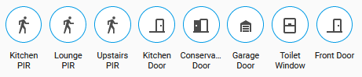
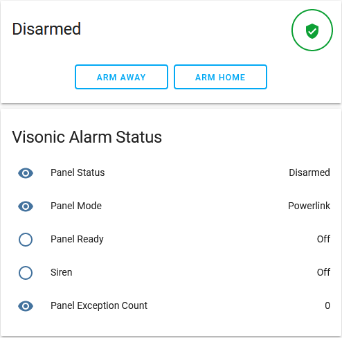

> **Idioma / Language:** [Read in English](https://github.com/ShaneGooseman/visonic/wiki) | **Español**

# Panel de Alarma Visonic para Home Assistant

**Integración personalizada local** para Home Assistant (bifurcada de [davesmeghead/visonic](https://github.com/davesmeghead/visonic) y mantenida en [ShaneGooseman/visonic](https://github.com/ShaneGooseman/visonic)).

## Introducción

Visonic fabrica las series de paneles de alarma PowerMax y PowerMaster. Esta integración de Home Assistant se conecta **de forma local** a tu panel de alarma para monitorizar sensores, armar/desarmar el sistema, controlar interruptores X10/PGM y automatizar respuestas.

> **Nota sobre este fork (`0.12.6.0`):** Este fork está centrado en **conexiones locales directas** (Ethernet TCP / ESPHome / `visonic_proxy` y USB/RS-232). Las conexiones en la nube (por ejemplo, sondeo a servidores Tyco / Visonic Go) no forman parte de esta rama.

Existen 4 opciones de conexión local:
1. **Serie directo (USB / RS-232 TTL):** Un cable USB-a-TTL conectado directamente al conector interno PC/IP o RS-232 del panel.
2. **Ethernet directo (puente serie a TCP):** Un conversor serie-a-Ethernet cableado o Wi-Fi (como USR-TCP232-T2/E2, USR-WIFI232-D2, NodeMCU con `esp-link` o `ser2net` en una Raspberry Pi).
3. **Puente serie con ESPHome:** Un ESP32 o ESP8266 ejecutando ESPHome con `stream_server` (las plantillas YAML listas para usar están en `custom_components/visonic/examples/esphome/`).
4. **Ethernet mediante proxy (`visonic_proxy` + PowerLink 3.1):** Permite usar tu módulo hardware PowerLink 3.1 junto con [`visonic_proxy`](https://github.com/msp1974/visonic_proxy) para que la app móvil de Visonic y Home Assistant funcionen simultáneamente. Este fork incluye **autodescubrimiento Zeroconf** (`_visonic._tcp.local.`), **revinculación de entidades en reconexiones** y **optimización de keepalives en modo Powerlink (Puenteado)** (suprimiendo `AB 03` redundantes para no competir con la app móvil).

## Novedades y mejoras de este fork
- **Arquitectura por capas:** Lógica principal en `custom_components/visonic/core/` (`client.py`, `transport.py`, `event_coordinator.py`, `event_log.py`, `registry.py`, `schema.py`) y capa de protocolo en `custom_components/visonic/protocol/` (`visonic.py`, `helper.py`, `eprom.py`, `const.py`, `enums.py`).
- **Entidades nativas de Home Assistant (`has_entity_name = True`, `manufacturer = "Visonic"`):**
  - Cada zona expone sensores binarios de diagnóstico dedicados (**Sabotaje / Tamper** y **Batería**, `EntityCategory.DIAGNOSTIC`).
  - Las zonas PowerMaster compatibles exponen sensores nativos de medición (**Temperatura** en °C e **Iluminancia** en lx).
  - El sensor de panel en modo Mínimo utiliza `SensorEntity` nativo.
- **Reconfiguración directa y Zeroconf:** Actualiza host/puerto/USB desde **Reconfigurar** sin eliminar la integración; los proxies compatibles se descubren automáticamente por Zeroconf.
- **Endurecimiento de seguridad y privacidad:**
  - La exportación del registro de eventos en XML/CSV está restringida estrictamente al directorio `/config` de Home Assistant (se bloquea *path traversal* y se usa codificación UTF-8).
  - Los campos sensibles de la EPROM (`duress`, `pagerPIN`, `accountNo`, `centralStation`, `pagerNr`) se ocultan de los atributos y se redactan en los diagnósticos.
- **Sin dependencia de `Pillow`:** El análisis de imágenes JPEG de cámaras PIR se realiza en Python puro (solo requiere `serialx`).
- **Iconos locales e interfaz en español:** Recursos visuales claros y oscuros en `custom_components/visonic/brand/` y traducción completa al español (`translations/es.json`).

## Índice
- [Aspecto en la interfaz](#aspecto-en-la-interfaz)
- [Paneles Visonic compatibles](#paneles-visonic-compatibles)
- [Funcionalidad y entidades compatibles](#funcionalidad-y-entidades-compatibles)
- [Configuración de hardware](https://github.com/ShaneGooseman/visonic/wiki/Hardware-Setup-ES)
- [Instalación en Home Assistant](#instalacion-en-home-assistant)
- [Modos de emulación](#modos-de-emulacion)
- [Cómo lograr el modo PowerLink mediante enrolamiento manual](#como-lograr-el-modo-powerlink-mediante-enrolamiento-manual)
- [Secuencia de arranque y reconexión](#secuencia-de-arranque-y-reconexion)
- [El ajuste del código de descarga EPROM](#el-ajuste-del-codigo-de-descarga-eprom)
- [Creación, modificación, reconfiguración y eliminación](#creacion-modificacion-reconfiguracion-y-eliminacion)
- [Parámetros de configuración](#parametros-de-configuracion)
- [Clase de dispositivo (`device_class`)](#clase-de-dispositivo-device_class)
- [Servicios del panel en Home Assistant](#servicios-del-panel-en-home-assistant)
- [Eventos del panel en Home Assistant](#eventos-del-panel-en-home-assistant)
- [Ejemplos de automatizaciones](#ejemplos-de-automatizaciones)
- [Atributos de la entidad del panel](#atributos-de-la-entidad-del-panel)
- [Utilidades adicionales (Ejemplos y puente)](#utilidades-adicionales-ejemplos-y-puente)
- [Solución de problemas](#solucion-de-problemas)
- [Protocolo de interacción con el panel](#protocolo-de-interaccion-con-el-panel)
- [Configuración de logs (Logger)](#configuracion-de-logs-logger)
- [Notas técnicas del panel](https://github.com/ShaneGooseman/visonic/wiki/Panel-Stuff-ES)

---

<a name="aspecto-en-la-interfaz"></a>
# Aspecto en la interfaz

Ejemplo de sensores en Home Assistant:



Ejemplo de tarjetas en Lovelace:



Puedes crear sensores de plantilla a partir de los atributos de `alarm_control_panel.visonic_alarm` mediante la [integración Template de Home Assistant](https://www.home-assistant.io/integrations/template/).

---

<a name="paneles-visonic-compatibles"></a>
# Paneles Visonic compatibles

| Modelo de panel | Comentario |
|-----------------|------------|
| PowerMax (original) | *No compatible.* No soporta el protocolo Powerlink necesario para esta integración. |
| PowerMax+ | Compatible. Requiere enrolamiento manual (Nota 1). |
| PowerMax Pro | Compatible. Requiere enrolamiento manual (Nota 1). |
| PowerMax Complete | Compatible con autoenrolamiento. |
| PowerMax Pro Part | Compatible con autoenrolamiento. |
| PowerMax Complete Part | Compatible con autoenrolamiento. |
| PowerMax Express | Compatible con autoenrolamiento. |
| PowerMaster 10 | Compatible con autoenrolamiento (Nota 2). |
| PowerMaster 30 | Compatible con autoenrolamiento (Nota 2). |
| PowerMaster 33 | Compatible con autoenrolamiento (Nota 2). |
| PowerMaster 360 | Limitado al modo de emulación Estándar Plus (Notas 2 y 3). |
| PowerMaster 360R | Limitado al modo de emulación Estándar Plus (Notas 2 y 3). |

- **Nota 1:** En PowerMax+ y PowerMax Pro es necesario enrolar manualmente a los pocos minutos de iniciar la integración desde el menú del panel: `MODO INSTALADOR → 7. ENROL PWRLNK → 01: INSTALAR`.
- **Nota 2:** Para recibir detecciones de movimiento PIR con la alarma desarmada, desactiva el ahorro de batería de cada PIR en el panel: `MODO INSTALADOR → ZONAS Y DISPOSITIVOS → MODIFICAR DISPOSITIVO → SENSORES MOVIMIENTO → AJUSTES → ACTIVIDAD DESARMADO → SÍ +0 SEGUNDOS`.
- **Nota 3:** Los PowerMaster 360 y 360R integran hardware PowerLink interno, por lo que el modo máximo alcanzable por USB es Estándar Plus.

## Aviso de seguridad
La seguridad de tu sistema de alarma y tu red local es tu responsabilidad. El tráfico serie/TCP local entre Home Assistant y el panel **no está cifrado**. Al descargar la EPROM, armar/desarmar o solicitar el registro de eventos, los códigos de usuario y descarga viajan por ese enlace local. Mantén el puente de la alarma en una red/VLAN de confianza.

---

<a name="funcionalidad-y-entidades-compatibles"></a>
# Funcionalidad y entidades compatibles

Se admiten múltiples paneles Visonic de forma simultánea. Cada panel configurado crea un **Hub** en Home Assistant con su propio número de panel (`0`, `1`, `2`, ...).

### Dispositivos y entidades creadas
- **Dispositivo del panel de alarma:**
  - `alarm_control_panel`: Arma y desarma el panel, expone atributos de estado y (en PowerMaster) permite disparar alarmas de Intrusión, Incendio, Emergencia y Pánico. *(En modo Mínimo se crea un `sensor` de solo lectura en lugar de `alarm_control_panel`.)*
  - `siren`: Entidad de sirena asociada al dispositivo del panel.
- **Dispositivos de sensores de zona (un dispositivo HA por cada zona registrada):**
  - `binary_sensor` (estado principal de la zona: movimiento, contacto puerta/ventana, humo, gas, inundación, etc.).
  - `binary_sensor` **Tamper / Sabotaje** (`device_class: tamper`, `EntityCategory.DIAGNOSTIC`).
  - `binary_sensor` **Batería** (`device_class: battery`, `EntityCategory.DIAGNOSTIC`).
  - `select` (selector de modo **Armado / Anulado (Bypass)** cuando el panel admite bypass).
  - `sensor` **Temperatura** (`°C`, `device_class: temperature`) e **Iluminancia** (`lx`, `device_class: illuminance`) en detectores PowerMaster compatibles.
  - `image`: Entidad de imagen para cámaras PIR PowerMaster.
- **Dispositivos de interruptores X10 / PGM:**
  - Entidad `switch` para cada dispositivo X10 y para la salida PGM del panel (cuando es compatible).

> **Nota sobre nombres de entidades:** Todas las plataformas usan `has_entity_name = True`, por lo que Home Assistant compone el nombre a partir del dispositivo y la función de la entidad (por ejemplo `Z01 Tamper`, `Z01 Battery`, `Z01 Temperature`).

---

<a name="instalacion-en-home-assistant"></a>
# Instalación en Home Assistant

Para el cableado y hardware necesario consulta [Configuración de hardware](https://github.com/ShaneGooseman/visonic/wiki/Hardware-Setup-ES).

1. **Mediante HACS (recomendado):**
   - Abre HACS → Integraciones → menú (`⋮`) → **Repositorios personalizados**.
   - Añade `https://github.com/ShaneGooseman/visonic` con categoría **Integración**.
   - Instala **Visonic Intruder Alarm** y reinicia Home Assistant.
2. **Instalación manual:**
   - Descarga el ZIP desde [ShaneGooseman/visonic](https://github.com/ShaneGooseman/visonic) y copia `custom_components/visonic` en `/config/custom_components/visonic`.
   - Reinicia Home Assistant.

---

<a name="modos-de-emulacion"></a>
# Modos de emulación

Al configurar la integración eliges el modo de emulación deseado: **Mínimo (Minimal)**, **Estándar (Standard)** o **Powerlink**. Si solicitas **Powerlink** y no se logra, la integración desciende a **Estándar Plus** (si la EPROM se descargó) o a **Estándar**.

- **Modo Mínimo (`Minimal`):** Solo lectura. No se envían comandos de armado/desarmado, no se descarga la EPROM ni los códigos de usuario y se crea un `sensor` de solo lectura en lugar de `alarm_control_panel`.
- **Modo Estándar (`Standard`):** Estado básico y sensores sin descarga de EPROM. Permite armar y desarmar introduciendo el código de usuario o mediante teclado.
- **Modo Estándar Plus (`Standard Plus`, automático):** Se descargó la EPROM (tipos de sensores y códigos disponibles), pero no se completó el enrolamiento Powerlink.
- **Modo Powerlink / Powerlink (Puenteado):** Interacción completa con keepalives continuos, estado detallado del panel e indicador de sirena. Al conectarse a través de `visonic_proxy` con un PowerLink 3.1, el modo muestra **Powerlink (Puenteado)** y omite los keepalives `AB 03` redundantes.

<a name="como-lograr-el-modo-powerlink-mediante-enrolamiento-manual"></a>
### Cómo lograr el modo PowerLink mediante enrolamiento manual
Solo necesario en **PowerMax+** y **PowerMax Pro**:
1. Inicia la integración en Home Assistant y espera a que finalice la descarga de la EPROM (1–2 minutos).
2. En el teclado del panel entra en `MODO INSTALADOR → 7. ENROL PWRLNK → 01: INSTALAR`.
3. En pocos minutos el atributo `emulationmode` de `alarm_control_panel.visonic_alarm` pasará a `Powerlink`.

<a name="secuencia-de-arranque-y-reconexion"></a>
### Secuencia de arranque y reconexión
1. Abre la conexión Ethernet (TCP) o USB/RS-232 configurada.
2. Según el modo solicitado:
   - **Mínimo / Estándar:** entra directamente.
   - **Powerlink:** descarga la EPROM (10–50 s) → pasa a **Estándar Plus** → intenta autoenrolar cada 4 minutos hasta lograr **Powerlink** (o **Powerlink (Puenteado)**).
3. Ante una desconexión:
   - Las entidades pasan limpiamente a estado `unavailable`.
   - Se reintenta según `Número de intentos de reconexión` y `Tiempo de espera entre intentos`.
   - Al reconectar, las entidades existentes se **revinculan automáticamente** a la nueva sesión sin crear entidades duplicadas.

<a name="el-ajuste-del-codigo-de-descarga-eprom"></a>
### El ajuste del código de descarga EPROM
Se utiliza para descargar la EPROM en modos Estándar Plus y Powerlink (**no** es el código de instalador). Déjalo vacío para probar los valores predeterminados (`5650` y `AAAA`). No lo configures como `0000` en el panel, ya que deshabilita la descarga de la EPROM.

---

<a name="creacion-modificacion-reconfiguracion-y-eliminacion"></a>
# Creación, modificación, reconfiguración y eliminación

Configura la integración desde **Ajustes → Dispositivos y servicios → + Añadir integración → Visonic Intruder Alarm** (`configuration.yaml` ya no está soportado).

- **Autodescubrimiento Zeroconf:** Los proxies compatibles que anuncien `_visonic._tcp.local.` (como `visonic_proxy`) aparecen automáticamente en **Dispositivos y servicios** para añadirlos en un clic.
- **Configurar (Opciones):** Modifica retardos, permisos de armado/desarmado, disparadores de sirena, notificaciones y exportación de logs sin borrar la integración.
- **Reconfigurar:** Permite cambiar los parámetros de conexión Ethernet (`host`, `port`, `esphome_entity_select`) o USB (`path`, `baud`) directamente desde el menú de la integración sin eliminarla.
- **Recargar:** Reinicia la integración con la configuración actual.

### Múltiples paneles Visonic
Cada panel debe tener un **Número de panel** único:
- Panel `0`: prefijo `visonic_` (ej. `alarm_control_panel.visonic_alarm`, `binary_sensor.visonic_z01`).
- Panel `N` (`N > 0`): incluye `pN` (ej. `binary_sensor.visonic_p2_z01`).

<a name="parametros-de-configuracion"></a>
### Parámetros de configuración

Los parámetros marcados con `*` se establecen al crear la integración (los de conexión también se pueden editar con **Reconfigurar**).

| C | Parámetro | Predeterminado | Descripción |
|---|-----------|----------------|-------------|
| * | Tipo de dispositivo | Ethernet | `Ethernet` (host/puerto TCP) o `USB` (ruta serie local y baudios). |
| * | Número de panel | `0` | Entero único por panel (`0`, `1`, `2`, ...). |
| * | Dirección del host / Puerto | — | IP/hostname y puerto TCP para Ethernet/ESPHome/`visonic_proxy`. |
| * | Entidad de baudios ESPHome | — | Entidad `select` de ESPHome opcional para cambiar baudios (PowerMaster 10/30). |
| * | Ruta USB / Baudios | `/dev/ttyUSB0` / `9600` | Ruta del dispositivo serie y velocidad (`9600` o `38400`). |
| * | Modo de emulación | `Powerlink` | `Powerlink`, `Standard` o `Minimal`. |
| * | Sensores a excluir | `""` | Lista separada por comas de zonas a excluir (ej. `2,3`). |
| * | Dispositivos X10 a excluir | `""` | Lista separada por comas de X10 a excluir (`0` = PGM, `1..15` = X10). |
| * | Código de descarga EPROM | `""` | Código de 4 dígitos (vacío para usar los predeterminados `5650` / `AAAA`). |
| | Mostrar datos EPROM | `No` | Muestra atributos EPROM no sensibles en el panel. Los campos sensibles (`duress`, `pagerPIN`, `accountNo`, `centralStation`, `pagerNr`) siempre permanecen ocultos. |
| | Retardo movimiento/cámara | `120` | Segundos que permanece activa una detección de movimiento/cámara. |
| | Retardo contacto magnético/cableado | `5` | Segundos que permanece abierto un contacto. |
| | Retardo humo/incendio | `120` | Segundos que permanece activa una alerta de humo/gas/inundación/emergencia. |
| | Disparadores de la sirena | `Intrusión` | Motivos que activan el estado de sirena (`Intrusión`, `Sabotaje`, `Incendio`, `Emergencia`, `Gas`, `Inundación`, `X10`, `Pánico`). |
| | Disparadores de notificaciones HA | `Problemas de conexión`, `Sirena sonando` | Notificaciones persistentes generadas en Home Assistant. |
| | Intentos de reconexión | `1` | Número de intentos (`0` = solo intenta conectar al arrancar). |
| | Espera entre intentos | `90` | Segundos entre reintentos de reconexión. |
| | Armar sin código de usuario | `No` | Permite armar sin introducir código (según modelo de panel). |
| | Forzar teclado numérico | `No` | Exige introducir siempre el código en el teclado de HA. |
| | Armado en casa / noche | `Sí` / `Sí` | Habilita los modos de armado en casa y nocturno. |
| | Armado ausente / en casa instantáneo | `No` / `No` | Realiza armado instantáneo (sin retardo de entrada). |
| | Permitir armado / desarmado remoto | `No` / `No` | Autoriza armar y desarmar el panel desde Home Assistant. |
| | Permitir anulación (bypass) | `No` | Permite anular sensores individuales desde HA. |
| | Archivo XML / CSV de registro | `""` | Ruta relativa **dentro de `/config`** para exportar el historial (se bloquea cualquier ruta fuera de `/config`). Copia `custom_components/visonic/examples/visonic_template.xml` a `/config/templates/` (o `/config/xml/`, `/config/www/`, `/config/`) para personalizar el XML. |
| | Opciones de registro | — | Eventos HA por entrada o al finalizar, fila de encabezado CSV, orden inverso, máximo de entradas (`10000`). |

---

<a name="clase-de-dispositivo-device_class"></a>
# Clase de dispositivo (`device_class`)

En modos Estándar Plus y Powerlink se asignan valores predeterminados (`motion` para PIR, `window` para contactos magnéticos, `door` para cableados). Puedes cambiar el tipo visual de cualquier sensor desde la interfaz de Home Assistant (**Ajustes de la entidad → Mostrar como**) o en `customize.yaml`.

---

<a name="servicios-del-panel-en-home-assistant"></a>
# Servicios del panel en Home Assistant

| Servicio | Código | Descripción |
|----------|--------|-------------|
| `alarm_control_panel.alarm_arm_away` | Opcional | Arma el panel en modo ausente. |
| `alarm_control_panel.alarm_arm_home` | Opcional | Arma el panel en modo en casa. |
| `alarm_control_panel.alarm_disarm` | Opcional | Desarma el panel. |
| `visonic.alarm_panel_command` | Opcional | Envía `Arm Away`, `Arm Away Instant`, `Arm Away Bypass`, `Arm Home`, `Arm Home Instant`, `Arm Home Bypass`, `Disarm`, o (en PowerMaster) `Emergency`, `Fire`, `Panic`, `Mute`, `Trigger`. |
| `visonic.alarm_sensor_bypass` | Opcional | Anula (`true`) o reactiva (`false`) un sensor individual con el panel desarmado. |
| `visonic.alarm_panel_eventlog` | Opcional | Descarga el historial de eventos del panel y genera XML/CSV/eventos. |
| `visonic.alarm_panel_reconnect` | — | Desconecta y reconecta el canal de comunicación con el panel sin recargar HA. |
| `visonic.alarm_panel_zoneinfo` | — | Devuelve el resumen actual de sensores y dispositivos X10 (`validity`, abiertos, anulados, batería baja). |
| `visonic.alarm_panel_x10` | — | Envía `Off`, `On`, `Dimmer` o `Brighten` a un interruptor X10/PGM. |
| `visonic.alarm_sensor_image` | — | Solicita la última imagen a una cámara PIR PowerMaster. |

---

<a name="eventos-del-panel-en-home-assistant"></a>
# Eventos del panel en Home Assistant

Todos los eventos incluyen `panel` (entero) y `panel_id` (ej. `alarm_control_panel.visonic_alarm`):

- **`visonic_alarm_panel_state`:** Estado de conexión (`connection`: `connected` / `disconnected` / `failedattempt`), `nopaneldata` (`neverconnected` / `disconnected`), `panelupdate`, `panelreset`, `pinrejected`, `imageupdate`, `timeoutdownload`, `timeoutwaiting`, `timeoutactive`.
- **`visonic_alarm_command_to_panel`:** Resultado de comandos enviados (`armdisarm`, `bypass`, `eventlog`, `x10`), con `command`, `reason` (`0` = enviado, `1..6` = bloqueado/error), `message`, `ready`, `open`, `bypass`, `tamper`, `zonetamper`.
- **`visonic_alarm_panel_event_log_entry`** y **`visonic_alarm_panel_event_log_complete`:** Emitidos durante y al finalizar la descarga del registro de eventos si están habilitados.

---

<a name="ejemplos-de-automatizaciones"></a>
# Ejemplos de automatizaciones

```yaml
- alias: Alarma armada - Apagar luces
  triggers:
    - trigger: state
      entity_id: alarm_control_panel.visonic_alarm
      to: "armed_away"
  actions:
    - action: script.alarm_armed

- alias: Notificación al sonar la sirena
  triggers:
    - trigger: state
      entity_id: siren.visonic_s01
      from: "off"
      to: "on"
  actions:
    - action: notify.persistent_notification
      data:
        title: "Sirena activada ({{ trigger.to_state.attributes.friendly_name }})"
        message: >-
          Alarma disparada ({{ trigger.to_state.attributes.alarm }}).
          
          Sensor: {{ trigger.to_state.attributes.trigger }}
          
```

---

<a name="atributos-de-la-entidad-del-panel"></a>
# Atributos de la entidad del panel

Principales atributos en `alarm_control_panel.visonic_alarm` (los de nombre en minúsculas se traducen automáticamente en la interfaz de Home Assistant):
- `state`, `ready`, `memory`, `trouble`, `bypass`, `tamper`, `battery_level`, `alarm`
- `emulationmode` (`Desconocido`, `Problema`, `Iniciando`, `Descargando EPROM`, `Conexión mínima del panel`, `Estándar`, `Estándar Plus`, `Powerlink`, `Powerlink (Puenteado)`, `Integración detenida`)
- `Panel Model`, `Power Master`, `Protocol Version`, `Client Version`, `panel`
- `Watchdog Timeout (Total)`, `Watchdog Timeout (Past 24 Hours)`, `Download Timeout`, `Download Retries`, `Disconnection Count`
- `lasteventname`, `lasteventaction`, `lasteventtime`

---

<a name="utilidades-adicionales-ejemplos-y-puente"></a>
# Utilidades adicionales (Ejemplos y puente)

Las herramientas independientes y plantillas ESPHome se encuentran en `custom_components/visonic/examples/`:

- **`examples/bridge.py`:** Puentea una conexión TCP del panel a un puerto COM virtual (por ejemplo `com0com` en Windows) para usar *PowerMaster Remote Programmer*:
  ```bash
  python3 custom_components/visonic/examples/bridge.py -address 192.168.X.Y -port TuPuerto -usb COM1
  ```
- **`examples/simple_example.py`** y **`examples/complete_example.py`:** Permiten probar la comunicación con el panel por línea de comandos sin Home Assistant (instala las dependencias con `pip install -r custom_components/visonic/examples/requirements.txt`; ya no se requiere `Pillow`).
- **`examples/MessageDecoder.py`:** Decodifica tramas hexadecimales capturadas de Visonic sin conexión.
- **`examples/visonic_template.xml`:** Plantilla Jinja2 de ejemplo para exportar el registro de eventos en XML.
- **`examples/esphome/`:** Plantillas YAML de ESPHome listas para ESP32 (`visonic_esphome_esp32_serial_bridge.yaml`), M5Stack PoESP32 (`visonic_esphome_poesp32_serial_bridge.yaml`) y Wemos D1 R2 (`visonic_esphome_wemos_d1_r2_siren.yaml`).

---

<a name="solucion-de-problemas"></a>
# Solución de problemas

- **Conexión rechazada (`Errno 111`):** Comprueba IP/puerto y que tu puente TCP, `stream_server` de ESPHome o `visonic_proxy` esté en ejecución.
- **Sin datos del panel (`nopaneldata`):** Verifica el cruce TX→RX / RX→TX, masa común (GND) y velocidad en baudios (`9600` para firmware ≤ 17.133; `38400` en la mayoría de ≥ 18.xxx).
- **Atascado en modo Estándar o Descarga:** Reinicia el panel entrando y saliendo del Modo Instalador en el teclado (sin resetear ajustes), espera 2 minutos y recarga la integración.
- **Prueba de bucle (Loopback):** Desconecta TX/RX del panel y une TX con RX en tu adaptador; la integración registrará `LOOPBACK TEST SUCCESS` en el log para confirmar que el enlace serie/TCP funciona.
- **La sirena no aparece disparada en HA:** Comprueba que estás en modo Powerlink, revisa `Lista de disparadores de la sirena` y configura `10:ABORT TIME` a `00` segundos en paneles PowerMaster.
- **Problemas USB en Debian/Ubuntu:** Desinstala `brltty` (`sudo apt remove brltty`) y desactiva `ModemManager` (`sudo systemctl disable --now ModemManager`) si bloquean `/dev/ttyUSB0`.

---

<a name="protocolo-de-interaccion-con-el-panel"></a>
# Protocolo de interacción con el panel

La comunicación utiliza tramas binarias **PDU (Protocol Data Units)** con el formato:
`0x0d` (cabecera) + `ID de PDU` + `carga útil` + `checksum` + `0x0a` (pie).
Ejemplo (trama de estado `A5`): `0d a5 00 04 00 61 03 05 00 05 00 00 43 a4 0a`.

---

<a name="configuracion-de-logs-logger"></a>
# Configuración de logs (Logger)

Para habilitar el registro de depuración en `configuration.yaml`:

```yaml
logger:
  default: error
  logs:
    custom_components.visonic: debug
```

---

*Integración y documentación originales por [@davesmeghead](https://github.com/davesmeghead/visonic). Mantenida y actualizada en este fork por [@ShaneGooseman](https://github.com/ShaneGooseman/visonic).*
