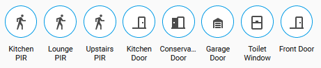
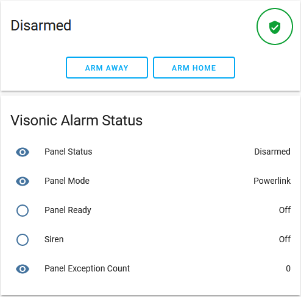

> **Idioma / Language:** **English** | [Leer en Español](https://github.com/ShaneGooseman/visonic/wiki/Home-ES)

# Visonic Alarm Panel for Home Assistant

A local **Custom Integration** for Home Assistant (forked from [davesmeghead/visonic](https://github.com/davesmeghead/visonic) and maintained at [ShaneGooseman/visonic](https://github.com/ShaneGooseman/visonic)).

## Introduction

Visonic produces the PowerMax and PowerMaster alarm panel series. This Home Assistant integration connects **locally** to your alarm panel and allows you to monitor sensors, control arming/disarming, manage X10/PGM switches, and automate responses.

> **Note about this fork (`1.0.0`):** This fork focuses on **Direct Local Connections** (Ethernet TCP / ESPHome / `visonic_proxy` and USB/RS-232). Cloud connections (e.g., Tyco / Visonic Go cloud polling) are not part of this branch.

There are 4 local connection methods:
1. **Direct Serial (USB / RS-232 TTL):** A USB-to-TTL serial cable connected directly to the panel's internal PC/IP or RS-232 header.
2. **Direct Ethernet (TCP Serial Bridge):** A wired or Wi-Fi serial-to-TCP bridge (such as USR-TCP232-T2/E2, USR-WIFI232-D2, NodeMCU with `esp-link`, or `ser2net` on a Raspberry Pi).
3. **ESPHome Serial Bridge:** An ESP32 / ESP8266 running ESPHome with `stream_server` (ready-to-use YAML examples are included in `custom_components/visonic/examples/esphome/`).
4. **Proxy Ethernet (`visonic_proxy` + PowerLink 3.1):** Use your existing PowerLink 3.1 hardware module together with [`visonic_proxy`](https://github.com/msp1974/visonic_proxy) so both the Visonic mobile app and Home Assistant can operate simultaneously. This fork includes **Zeroconf auto-discovery** (`_visonic._tcp.local.`), **reconnection entity rebinding**, and **Powerlink (Bridged) keepalive optimization** (suppressing redundant `AB 03` keepalives in bridge mode to avoid channel contention with the mobile app).

## What's Updated in This Fork
- **Layered architecture:** Core runtime under `custom_components/visonic/core/` (`client.py`, `transport.py`, `event_coordinator.py`, `event_log.py`, `registry.py`, `schema.py`) and protocol layer under `custom_components/visonic/protocol/` (`visonic.py`, `helper.py`, `eprom.py`, `const.py`, `enums.py`).
- **Native Home Assistant entities (`has_entity_name = True`, `manufacturer = "Visonic"`):**
  - Each zone exposes dedicated diagnostic binary sensors (**Tamper** and **Battery**, `EntityCategory.DIAGNOSTIC`).
  - Supported PowerMaster zones expose native measurement sensors (**Temperature** in °C and **Illuminance** in lx).
  - Minimal mode panel sensor uses native `SensorEntity`.
- **In-place Reconfigure & Zeroconf:** Update host/port/USB settings directly via **Reconfigure** without deleting the integration; compatible proxies are discovered automatically via Zeroconf.
- **Security & privacy hardening:**
  - Event log XML/CSV exports are restricted strictly inside Home Assistant's `/config` directory (path traversal blocked, UTF-8 encoding).
  - Sensitive EPROM fields (`duress`, `pagerPIN`, `accountNo`, `centralStation`, `pagerNr`) are excluded from attributes and redacted in diagnostics.
- **Zero `Pillow` dependency:** Camera PIR JPEG dimensions are parsed in pure Python (only `serialx` is required).
- **Local brand icons & Spanish UI:** Light/dark brand assets in `custom_components/visonic/brand/` and full Spanish translation (`translations/es.json`).

## Contents
- [What the Frontend Looks Like](#what-my-frontend-looks-like)
- [Supported Visonic Panels](#supported-visonic-panels)
- [Supported Panel Functionality](#supported-panel-functionality)
- [Hardware Setup](https://github.com/ShaneGooseman/visonic/wiki/Hardware-Setup)
- [Installing the Software in to HA](#installing-the-software-in-to-ha)
- [The Different Emulation Modes](#the-different-emulation-modes)
- [Achieving PowerLink Mode by Manually Enrolling](#achieving-powerlink-emulation-mode-by-manually-enrolling)
- [The Start Up Sequence of the Integration](#the-start-up-sequence-of-the-integration)
- [The Download Code Setting](#the-download-code-setting)
- [Integration Creation, Modification and Deletion](#integration-creation-modification-and-deletion-from-within-home-assistant)
- [Configuration Settings](#configuration-settings)
- [Home Assistant `device_class`](#home-assistant-device_class)
- [Home Assistant Panel Services](#home-assistant-panel-services)
- [Home Assistant Panel Events](#home-assistant-panel-events)
- [Home Assistant Automation Examples](#home-assistant-automation-examples)
- [Attributes of the Alarm Panel Entity](#attributes-of-the-alarm-panel-entity)
- [Extra Hidden Functionality (Examples & Bridge)](#extra-hidden-functionality)
- [Troubleshooting](#troubleshooting)
- [Panel Interaction Protocol](#panel-interactions)
- [Logger Settings](#logger-settings)
- [Visonic Panel Stuff](https://github.com/ShaneGooseman/visonic/wiki/Panel-Stuff)

---

# What my Frontend looks like

Example sensor list:



Example Lovelace cards:



You can create template sensors from attributes of `alarm_control_panel.visonic_alarm` using Home Assistant's [Template integration](https://www.home-assistant.io/integrations/template/).

---

# Supported Visonic Panels

| Panel Model | Comment |
|-------------|---------|
| PowerMax (original) | *Not supported.* Does not support the Powerlink protocol required by this integration. |
| PowerMax+ | Supported. Requires manual enrolment (Note 1). |
| PowerMax Pro | Supported. Requires manual enrolment (Note 1). |
| PowerMax Complete | Supported with auto-enrol. |
| PowerMax Pro Part | Supported with auto-enrol. |
| PowerMax Complete Part | Supported with auto-enrol. |
| PowerMax Express | Supported with auto-enrol. |
| PowerMaster 10 | Supported with auto-enrol (Note 2). |
| PowerMaster 30 | Supported with auto-enrol (Note 2). |
| PowerMaster 33 | Supported with auto-enrol (Note 2). |
| PowerMaster 360 | Limited to Standard Plus Emulation Mode (Notes 2 & 3). |
| PowerMaster 360R | Limited to Standard Plus Emulation Mode (Notes 2 & 3). |

- **Note 1:** PowerMax+ and PowerMax Pro users must manually enrol within a few minutes of starting the integration via `INSTALLER MODE → 7. ENROL PWRLNK → 01: INSTALL`.
- **Note 2:** To receive PIR motion triggers while the panel is disarmed, disable PIR battery saver per detector: `INSTALLER MODE → ZONES AND DEVICES → MODIFY DEVICE → MOTION SENSORS → DEVICE SETTINGS → DISARM ACTIVITY → YES +0 SECONDS`.
- **Note 3:** PowerMaster 360 / 360R have built-in PowerLink hardware, so the maximum achievable emulation mode over USB is Standard Plus.

## Security Notice
You are responsible for the security of your alarm system and local network. Direct serial/TCP traffic between Home Assistant and the panel is **not encrypted**. When downloading the EPROM, arming/disarming, or requesting the event log, user codes and download codes travel over that local link. Keep your alarm bridge on a trusted/isolated VLAN.

---

# Supported Panel Functionality

Multiple Visonic panels are supported simultaneously. Each configured panel acts as a Home Assistant **Hub** with its own unique Panel Number (`0`, `1`, `2`, ...).

### Devices & Entities Created
- **Alarm Panel Device:**
  - `alarm_control_panel`: Arm/disarm the panel, inspect status attributes, and (on PowerMaster) trigger Intruder, Fire, Emergency, and Panic alarms. *(In Minimal Mode, a read-only `sensor` entity is created instead of `alarm_control_panel`.)*
  - `siren`: Panel siren entity associated with the panel device.
- **Zone Sensor Devices (one HA Device per enrolled zone):**
  - `binary_sensor` (main zone state: motion, door/window contact, smoke, gas, flood, etc.).
  - `binary_sensor` **Tamper** (`device_class: tamper`, `EntityCategory.DIAGNOSTIC`).
  - `binary_sensor` **Battery** (`device_class: battery`, `EntityCategory.DIAGNOSTIC`).
  - `select` (**Armed / Bypass** mode selector when bypass is supported).
  - `sensor` **Temperature** (`°C`, `device_class: temperature`) and **Illuminance** (`lx`, `device_class: illuminance`) on supported PowerMaster sensors.
  - `image`: Camera PIR image entity (PowerMaster Camera PIRs).
- **X10 / PGM Switch Devices:**
  - `switch` entity per X10 device and for the panel PGM output (when supported).

> **Entity naming note:** Because all platforms use `has_entity_name = True`, Home Assistant builds entity names from the device name plus the entity function (for example `Z01 Tamper`, `Z01 Battery`, `Z01 Temperature`).

---

# Installing the Software in to HA

For hardware wiring and bridges, see [Hardware Setup](https://github.com/ShaneGooseman/visonic/wiki/Hardware-Setup).

1. **Via HACS (recommended):**
   - Open HACS → Integrations → menu (`⋮`) → **Custom repositories**.
   - Add `https://github.com/ShaneGooseman/visonic` with category **Integration**.
   - Install **Visonic Intruder Alarm** and restart Home Assistant.
2. **Manual installation:**
   - Download the repository ZIP from [ShaneGooseman/visonic](https://github.com/ShaneGooseman/visonic) and copy `custom_components/visonic` into your Home Assistant `/config/custom_components/visonic` folder.
   - Restart Home Assistant.

---

# The Different Emulation Modes

When adding the integration, you choose a requested Emulation Mode: **Minimal**, **Standard**, or **Powerlink**. If **Powerlink** is requested and cannot be achieved, the integration falls back to **Standard Plus** (if EPROM download succeeded) or **Standard**.

- **Minimal Mode:** Read-only monitoring. No commands (arm/disarm) are sent, EPROM is not downloaded, no user codes are retrieved, and a read-only `sensor` entity is created instead of `alarm_control_panel`.
- **Standard Mode:** Basic state and sensor reporting without EPROM download. You can arm/disarm by supplying the user code (or keypad).
- **Standard Plus Mode (automatic fallback):** EPROM was downloaded (providing rich sensor types and user codes), but full Powerlink enrolment was not achieved.
- **Powerlink Mode / Powerlink (Bridged):** Full interaction with continuous Powerlink keepalives, detailed panel status, and siren indications. When connected via `visonic_proxy` alongside a PowerLink 3.1 module, the mode reports **Powerlink (Bridged)** and suppresses redundant `AB 03` keepalives.

### Achieving PowerLink Emulation Mode by Manually Enrolling
Only required for **PowerMax+** and **PowerMax Pro** panels:
1. Start the integration in Home Assistant and wait for EPROM download to complete (1–2 minutes).
2. On the panel keypad, enter `INSTALLER MODE → 7. ENROL PWRLNK → 01: INSTALL`.
3. Within a few minutes, the `emulationmode` attribute of `alarm_control_panel.visonic_alarm` should change to `Powerlink`.

### The Start Up Sequence of the Integration
1. Opens the configured Ethernet (TCP) or USB/RS-232 connection.
2. Depending on requested mode:
   - **Minimal / Standard:** enters directly.
   - **Powerlink:** downloads EPROM (10–50 seconds) → enters **Standard Plus** → attempts auto-enrol every 4 minutes until **Powerlink** (or **Powerlink (Bridged)**) is achieved.
3. On disconnection:
   - Entities transition cleanly to `unavailable`.
   - The integration retries according to `Attempts to Try to Connect` and `Delay Between Attempts`.
   - Upon reconnection, existing entities are **rebound in-place** to the new protocol session without creating duplicate entities.

### The Download Code Setting
Used to download EPROM data in Standard Plus / Powerlink modes (this is **not** the Installer Code). Leave empty to try built-in defaults (`5650` and `AAAA`). Do not set it to `0000` on the panel, as that disables EPROM downloads.

---

# Integration Creation, Modification and Deletion from within Home Assistant

Configure the integration from **Settings → Devices & Services → + Add Integration → Visonic Intruder Alarm** (`configuration.yaml` is not supported).

- **Zeroconf Auto-Discovery:** Compatible proxies advertising `_visonic._tcp.local.` (such as `visonic_proxy`) appear automatically in **Devices & Services** for 1-click confirmation.
- **Configure (Options):** Edit operational settings (delays, arm/disarm permissions, siren triggers, notifications, event log export) without deleting the integration.
- **Reconfigure:** Update Ethernet (`host`, `port`, `esphome_entity_select`) or USB (`path`, `baud`) connection parameters directly from the integration menu without removing it.
- **Reload:** Restarts the integration with current settings.

### Multiple Visonic Alarm Panels
Each panel must have a unique **Panel Number**:
- Panel `0`: entities use `visonic_` prefix (e.g., `alarm_control_panel.visonic_alarm`, `binary_sensor.visonic_z01`).
- Panel `N` (`N > 0`): entities include `pN` (e.g., `binary_sensor.visonic_p2_z01`).

### Configuration Settings

Settings marked with `*` are configured at creation time (connection fields can also be updated via **Reconfigure**).

| C | Setting | Default | Description |
|---|---------|---------|-------------|
| * | Device Type | Ethernet | `Ethernet` (TCP host/port) or `USB` (local serial path & baud rate). |
| * | Panel Number | `0` | Unique integer per panel (`0`, `1`, `2`, ...). |
| * | Host / Port | — | IP/hostname and TCP port for Ethernet/ESPHome/`visonic_proxy`. |
| * | ESPHome Baud Entity | — | Optional ESPHome `select` entity to switch baud rate (PowerMaster 10/30). |
| * | USB Local Path / Baud | `/dev/ttyUSB0` / `9600` | Serial device path and baud rate (`9600` or `38400`). |
| * | Emulation Mode | `Powerlink` | `Powerlink`, `Standard`, or `Minimal`. |
| * | Sensor List to Exclude | `""` | Comma-separated zone numbers to exclude (e.g. `2,3`). |
| * | X10 Devices to Exclude | `""` | Comma-separated X10 IDs to exclude (`0` = PGM, `1..15` = X10). |
| * | EPROM Download Code | `""` | Optional 4-digit download code (leave empty for defaults `5650` / `AAAA`). |
| | Show EPROM Data | `No` | Expose non-sensitive EPROM attributes on the alarm entity. Sensitive fields (`duress`, `pagerPIN`, `accountNo`, `centralStation`, `pagerNr`) are always hidden. |
| | Motion/Camera Off Delay | `120` | Seconds to hold motion/camera trigger active. |
| | Magnet/Wired Closed Delay | `5` | Seconds to hold contact open state. |
| | Smoke/Fire Off Delay | `120` | Seconds to hold emergency/smoke/gas/flood trigger active. |
| | List of Triggers for Siren | `Intruder` | Alarm reasons that mark the siren active (`Intruder`, `Tamper`, `Fire`, `Emergency`, `Gas`, `Flood`, `X10`, `Panic`). |
| | List of Triggers for HA Notifications | `Connection Problems`, `Siren Sounding` | Persistent HA notifications to raise. |
| | Attempts to Try to Connect | `1` | Reconnection attempts (`0` = connect once at startup only). |
| | Delay Between Attempts | `90` | Seconds between reconnection attempts. |
| | Arm Without User Code | `No` | Allow arming without entering a user code (panel-dependent). |
| | Force Use of Numeric Keypad | `No` | Always require entering code on the HA keypad. |
| | Arm Home / Night Enabled | `Yes` / `Yes` | Enable Arm Home and Arm Night actions. |
| | Arm Away / Home Instant | `No` / `No` | Use Instant arming (no entry delay). |
| | Allow Remote Arm / Disarm | `No` / `No` | Permit arming/disarming from Home Assistant. |
| | Allow Sensor Bypass | `No` | Permit bypassing individual sensors from HA. |
| | Panel Log XML / CSV Filename | `""` | Relative path **inside `/config`** to export event log XML/CSV (path traversal outside `/config` is blocked). Copy `custom_components/visonic/examples/visonic_template.xml` into `/config/templates/` (or `/config/xml/`, `/config/www/`, `/config/`) to customize XML output. |
| | Panel Log Options | — | Completion/entry HA events, CSV header row, reverse order, max entries (`10000`). |

---

# Home Assistant `device_class`

In Standard Plus and Powerlink modes, the integration sets sensible defaults (`motion` for PIRs, `window` for magnets, `door` for wired). You can override any sensor's `device_class` directly from the Home Assistant UI (**Entity Settings → Show as**) or via `customize.yaml`.

---

# Home Assistant Panel Services

| Service | Code | Description |
|---------|------|-------------|
| `alarm_control_panel.alarm_arm_away` | Optional | Arm the panel away. |
| `alarm_control_panel.alarm_arm_home` | Optional | Arm the panel home. |
| `alarm_control_panel.alarm_disarm` | Optional | Disarm the panel. |
| `visonic.alarm_panel_command` | Optional | Send `Arm Away`, `Arm Away Instant`, `Arm Away Bypass`, `Arm Home`, `Arm Home Instant`, `Arm Home Bypass`, `Disarm`, or (PowerMaster) `Emergency`, `Fire`, `Panic`, `Mute`, `Trigger`. |
| `visonic.alarm_sensor_bypass` | Optional | Bypass (`true`) or re-arm (`false`) an individual sensor while disarmed. |
| `visonic.alarm_panel_eventlog` | Optional | Download the panel event log and export XML/CSV/events. |
| `visonic.alarm_panel_reconnect` | — | Disconnect and reconnect to the panel cleanly without reloading HA. |
| `visonic.alarm_panel_zoneinfo` | — | Return current sensor/X10 summary (`validity`, open, bypassed, low battery). |
| `visonic.alarm_panel_x10` | — | Send `Off`, `On`, `Dimmer`, or `Brighten` to an X10/PGM switch. |
| `visonic.alarm_sensor_image` | — | Request latest image from a PowerMaster Camera PIR sensor. |

---

# Home Assistant Panel Events

All events include `panel` (integer) and `panel_id` (entity_id, e.g., `alarm_control_panel.visonic_alarm`).

- **`visonic_alarm_panel_state`:** Connection status (`connection`: `connected` / `disconnected` / `failedattempt`), `nopaneldata` (`neverconnected` / `disconnected`), `panelupdate`, `panelreset`, `pinrejected`, `imageupdate`, `timeoutdownload`, `timeoutwaiting`, `timeoutactive`.
- **`visonic_alarm_command_to_panel`:** Feedback for commands (`armdisarm`, `bypass`, `eventlog`, `x10`) including `command`, `reason` (`0` = sent, `1..6` = blocked/error), `message`, `ready`, `open`, `bypass`, `tamper`, `zonetamper`.
- **`visonic_alarm_panel_event_log_entry`** / **`visonic_alarm_panel_event_log_complete`:** Emitted during/after panel event log download if enabled.

---

# Home Assistant Automation Examples

```yaml
- alias: Alarm Armed - Turn Lights Off
  triggers:
    - trigger: state
      entity_id: alarm_control_panel.visonic_alarm
      to: "armed_away"
  actions:
    - action: script.alarm_armed

- alias: Alarm Siren Triggered Notification
  triggers:
    - trigger: state
      entity_id: siren.visonic_s01
      from: "off"
      to: "on"
  actions:
    - action: notify.persistent_notification
      data:
        title: "{{ trigger.to_state.attributes.friendly_name }} Siren Sounding"
        message: >-
          Alarm triggered ({{ trigger.to_state.attributes.alarm }}).
          
          Sensor: {{ trigger.to_state.attributes.trigger }}
          
```

---

# Attributes of the Alarm Panel Entity

Key attributes on `alarm_control_panel.visonic_alarm` (lowercase keys are translated by Home Assistant, including Spanish):
- `state`, `ready`, `memory`, `trouble`, `bypass`, `tamper`, `battery_level`, `alarm`
- `emulationmode` (`Unknown`, `Problem`, `Starting`, `Download`, `Minimal Only`, `Standard`, `Standard Plus`, `Powerlink`, `Powerlink (Bridged)`, `Stopped`)
- `Panel Model`, `Power Master`, `Protocol Version`, `Client Version`, `panel`
- `Watchdog Timeout (Total)`, `Watchdog Timeout (Past 24 Hours)`, `Download Timeout`, `Download Retries`, `Disconnection Count`
- `lasteventname`, `lasteventaction`, `lasteventtime`

---

# Extra Hidden Functionality

Standalone tools and ESPHome templates are organized under `custom_components/visonic/examples/`:

- **`examples/bridge.py`:** Bridge a TCP panel connection to a virtual COM port (e.g., `com0com` on Windows) for Visonic *PowerMaster Remote Programmer*:
  ```bash
  python3 custom_components/visonic/examples/bridge.py -address 192.168.X.Y -port YourPort -usb COM1
  ```
- **`examples/simple_example.py`** and **`examples/complete_example.py`:** Test panel communication from the CLI without Home Assistant (install dependencies with `pip install -r custom_components/visonic/examples/requirements.txt`; `Pillow` is no longer required).
- **`examples/MessageDecoder.py`:** Decode captured raw Visonic hex frames offline.
- **`examples/visonic_template.xml`:** Sample Jinja2 template for XML event log export.
- **`examples/esphome/`:** Ready-to-use ESPHome YAML templates for ESP32 (`visonic_esphome_esp32_serial_bridge.yaml`), M5Stack PoESP32 (`visonic_esphome_poesp32_serial_bridge.yaml`), and Wemos D1 R2 (`visonic_esphome_wemos_d1_r2_siren.yaml`).

---

# Troubleshooting

- **Connection refused (`Errno 111`):** Verify IP/port and that your TCP bridge, ESPHome `stream_server`, or `visonic_proxy` is running.
- **No data received (`nopaneldata`):** Check TX/RX wiring (TX→RX, RX→TX), GND reference, and baud rate (`9600` for firmware ≤ 17.133; `38400` for most ≥ 18.xxx).
- **Stuck in Standard or Download mode:** Perform a panel restart by entering and exiting Installer Mode on the keypad, wait 2 minutes, then reload the integration.
- **Loopback test:** Disconnect TX/RX from the panel and bridge TX↔RX on your adapter; the integration logs `LOOPBACK TEST SUCCESS` to confirm the serial/TCP path works.
- **Siren not showing in HA:** Ensure Powerlink mode is active, check `List of Triggers for Siren`, and set `10:ABORT TIME` to `00` seconds on PowerMaster panels.
- **Debian/Ubuntu USB issues:** Remove `brltty` (`sudo apt remove brltty`) and disable `ModemManager` (`sudo systemctl disable --now ModemManager`) if they claim `/dev/ttyUSB0`.

---

# Panel Interactions

Communication uses binary **Protocol Data Units (PDUs)** framed as:
`0x0d` (header) + `PDU ID` + `payload` + `checksum` + `0x0a` (footer).
Example (`A5` status frame): `0d a5 00 04 00 61 03 05 00 05 00 00 43 a4 0a`.

---

# Logger Settings

To enable debug logs in `configuration.yaml`:

```yaml
logger:
  default: error
  logs:
    custom_components.visonic: debug
```

---

*Original integration and documentation by [@davesmeghead](https://github.com/davesmeghead/visonic). Maintained and updated in this fork by [@ShaneGooseman](https://github.com/ShaneGooseman/visonic).*
