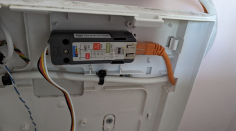
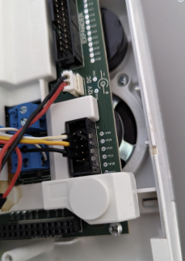
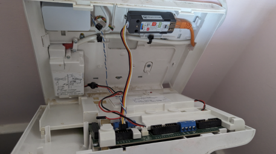

> **Language / Idioma:** [Read in English](https://github.com/ShaneGooseman/visonic/wiki/Using-M5Stack-ESP32-Ethernet-Unit-with-POE-M5Unit-PoESP32) | **Español**

# Uso de M5Stack ESP32 Ethernet con PoE (`M5Unit-PoESP32`)

Esta guía explica cómo flashear **ESPHome** en una unidad **M5Stack ESP32 Ethernet con PoE (`M5Unit-PoESP32`)** para crear un puente serie TTL a TCP cableado y alimentado por PoE para un panel Visonic PowerMax/PowerMaster.

> **Aviso:** Modificar el hardware de la alarma es bajo tu propia responsabilidad y puede anular la garantía de Visonic.

## Ventajas de `M5Unit-PoESP32`
- Mayor fiabilidad que Wi-Fi mediante Ethernet cableado
- Un único cable PoE (802.3af) para datos y alimentación — cabe dentro de la carcasa de la alarma
- Compatible con ESPHome con UART integrada (`TX: GPIO17`, `RX: GPIO16`) y PHY Ethernet `IP101`

## Hardware necesario
- M5Stack ESP32 Ethernet Unit con PoE (`M5Unit-PoESP32`)
- Cable M5Stack Grove2Dupont
- Switch o inyector PoE 802.3af
- Adaptador serie USB-a-TTL (solo para el primer flasheo) y cables puente

## Plantilla YAML de ESPHome
Utiliza la plantilla actualizada incluida en este repositorio:
- [`custom_components/visonic/examples/esphome/visonic_esphome_poesp32_serial_bridge.yaml`](https://github.com/ShaneGooseman/visonic/blob/master/custom_components/visonic/examples/esphome/visonic_esphome_poesp32_serial_bridge.yaml)

Configura `secrets.yaml` con `network_port` (ej. `10077`), `panel_baud_rate` (`9600` o `38400`) y `device_password`.

## Flasheo del `M5Unit-PoESP32`
1. Instala ESPHome (`pip install -U esphome`) o usa el panel de ESPHome en Home Assistant.
2. Abre la carcasa del `M5Unit-PoESP32` y conecta el adaptador USB-a-TTL manteniendo `G0` a `GND` al alimentar para entrar en modo bootloader (consulta [DrJohnM61/poesp32-esphome](https://github.com/DrJohnM61/poesp32-esphome) como referencia).
3. Flashea ejecutando:
   ```bash
   python -m esphome run visonic_esphome_poesp32_serial_bridge.yaml
   ```
4. Al terminar, conecta la unidad a tu switch PoE y verifica que recibe IP en tu red local.

## Instalación dentro del panel de alarma
1. Conecta el cable Grove2Dupont y el cable Ethernet y coloca la unidad en el hueco del soporte de pared:
   
2. Conecta los cables **blanco, amarillo y negro** (`TX`, `RX`, `GND`) al conector del panel. Aísla y aparta el cable **rojo** de alimentación (no se usa porque la unidad se alimenta por PoE):
   
3. Resultado final antes de cerrar la carcasa del panel:
   
4. Añade la integración **Visonic Intruder Alarm** en Home Assistant seleccionando **Ethernet** con la IP del `M5Unit-PoESP32` y el puerto TCP configurado.
