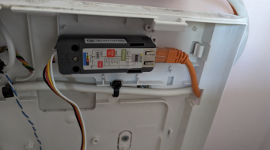
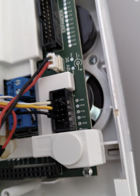
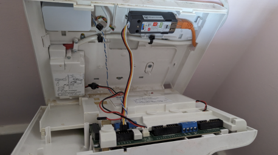

> **Language / Idioma:** **English** | [Leer en Español](https://github.com/ShaneGooseman/visonic/wiki/Using-M5Stack-ESP32-Ethernet-Unit-with-POE-M5Unit-PoESP32-ES)

# Using M5Stack ESP32 Ethernet Unit with PoE (`M5Unit-PoESP32`)

This guide explains how to flash **ESPHome** onto an **M5Stack ESP32 Ethernet Unit with PoE (`M5Unit-PoESP32`)** to create a wired, PoE-powered TCP-to-TTL serial bridge for a Visonic PowerMax/PowerMaster alarm panel.

> **Disclaimer:** Modifying alarm hardware is at your own risk and may void your Visonic warranty.

## Why `M5Unit-PoESP32`?
- Wired Ethernet reliability (no Wi-Fi dropouts)
- Single PoE (802.3af) cable for both data and power — fits cleanly inside the alarm housing
- Supported by ESPHome with onboard UART (`TX: GPIO17`, `RX: GPIO16`) and `IP101` Ethernet PHY

## Hardware Required
- M5Stack ESP32 Ethernet Unit with PoE (`M5Unit-PoESP32`)
- M5Stack Grove2Dupont cable
- 802.3af PoE switch or injector
- USB-to-TTL serial adapter (for initial flashing) and jumper wires

## ESPHome Configuration Template
Use the maintained YAML template included in this repository:
- [`custom_components/visonic/examples/esphome/visonic_esphome_poesp32_serial_bridge.yaml`](https://github.com/ShaneGooseman/visonic/blob/master/custom_components/visonic/examples/esphome/visonic_esphome_poesp32_serial_bridge.yaml)

Configure `secrets.yaml` with `network_port` (e.g., `10077`), `panel_baud_rate` (`9600` or `38400`), and `device_password`.

## Flashing the `M5Unit-PoESP32`
1. Install ESPHome (`pip install -U esphome`) or use the Home Assistant ESPHome Dashboard.
2. Open the `M5Unit-PoESP32` enclosure and connect your USB-to-TTL adapter while holding `G0` to `GND` during power-up to enter bootloader mode (see [DrJohnM61/poesp32-esphome](https://github.com/DrJohnM61/poesp32-esphome) for wiring reference).
3. Flash via:
   ```bash
   python -m esphome run visonic_esphome_poesp32_serial_bridge.yaml
   ```
4. Once flashed, connect the unit to your PoE switch and verify it obtains an IP on your LAN.

## Installing into the Alarm Panel
1. Attach the Grove2Dupont cable and Ethernet cable, and seat the unit in the wall-mount bracket slot:
   
2. Connect the **white, yellow, and black** Grove2Dupont leads (`TX`, `RX`, `GND`) to the panel header. Tuck the **red** power wire away (not needed because the unit is PoE-powered):
   
3. Final placement before closing the panel housing:
   
4. Add **Visonic Intruder Alarm** in Home Assistant using **Ethernet** with the `M5Unit-PoESP32` IP address and configured TCP port.
