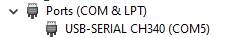
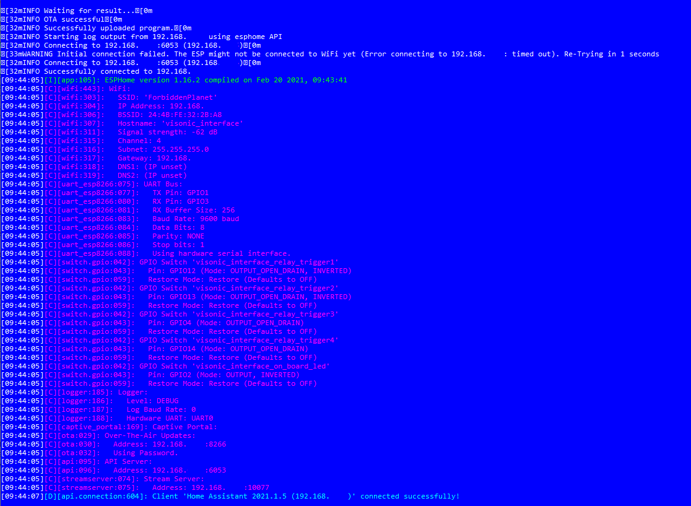

> **Language / Idioma:** [Read in English](https://github.com/ShaneGooseman/visonic/wiki/Using-Wemos-and-ESPHome) | **Español**

# Uso de Wemos D1 R2 y ESPHome (con disparo opcional de sirena)

Esta guía explica cómo usar una placa **Wemos D1 R2** (ESP8266) con **ESPHome** como puente serie TTL a TCP Wi-Fi entre un panel Visonic PowerMax/PowerMaster y Home Assistant, con soporte opcional de relés para disparar la sirena mediante una zona cableada.

> **Aviso:** Modificar el hardware de la alarma es bajo tu propia responsabilidad y puede anular la garantía de Visonic. Nunca alimentes el Wemos por USB y por el conector de 12 V simultáneamente.

## Hardware necesario
- Panel Visonic PowerMax/PowerMaster compatible ([Paneles compatibles](https://github.com/ShaneGooseman/visonic/wiki/Home-ES#paneles-visonic-compatibles))
- Wemos D1 R2 (ESP8266 con Wi-Fi, UART y entrada de alimentación 9–14 V CC)
- Cable de alimentación jack 5.5 mm × 2.1 mm y cables puente
- *Opcional (disparo de sirena):* Módulo relé 5 V CC (simple o doble) + 2 o 4 resistencias de 2.2 kΩ

## Plantilla YAML de ESPHome
En lugar de archivos ZIP externos, la plantilla actualizada se mantiene directamente en este repositorio:
- [`custom_components/visonic/examples/esphome/visonic_esphome_wemos_d1_r2_siren.yaml`](https://github.com/ShaneGooseman/visonic/blob/master/custom_components/visonic/examples/esphome/visonic_esphome_wemos_d1_r2_siren.yaml)
- *(Para placas ESP32 más modernas, consulta [`visonic_esphome_esp32_serial_bridge.yaml`](https://github.com/ShaneGooseman/visonic/blob/master/custom_components/visonic/examples/esphome/visonic_esphome_esp32_serial_bridge.yaml).)*

Configura tu `secrets.yaml` de ESPHome con tu Wi-Fi, IP estática, puerto TCP (ej. `10077`), velocidad en baudios del panel (`9600` o `38400`) y contraseña API/OTA.

## Flasheo con ESPHome
1. Conecta el Wemos D1 R2 por USB al PC y verifica el controlador CH340G en el Administrador de dispositivos de Windows (*Puertos COM y LPT*):
   
2. Usa el **panel de ESPHome** en Home Assistant (*Nuevo dispositivo → ESP8266 → Saltar → Editar → pegar YAML → Instalar*) o ejecuta por línea de comandos:
   ```bash
   pip install -U esphome
   python -m esphome run visonic_esphome_wemos_d1_r2_siren.yaml
   ```
   
3. Tras la primera carga por USB, las futuras actualizaciones se realizan por Wi-Fi (OTA).

## Relés y servicios de sirena (Opcional)
La plantilla expone 4 interruptores de relé (`D6`/`D7` activos en bajo, `D2`/`D5` activos en alto) y 2 servicios en Home Assistant (`esphome.visonic_interface_trigger_siren1` y `trigger_siren2`) que activan el relé durante 5 segundos. Cablea los terminales **Común (COM)** y **Normalmente Cerrado (NC)** con dos resistencias EOL de 2.2 kΩ a una zona cableada del panel para que el relé permanezca en reposo normalmente. Si el módulo relé tiene *jumper* de optoacoplador, retíralo.

## Instalación en el panel y alta en Home Assistant
1. **Alimentación:** Toma 12 V CC del bloque interno de alimentación del panel (**no** alimentes el Wemos desde el conector serie PC/IP). Si usas fuente USB externa, une la masa (**GND**) con el panel.
2. **Serie:** Conecta `TX` del Wemos → `RX` del panel y `RX` del Wemos → `TX` del panel en el conector PC/IP o PRG/PPA.
3. **Home Assistant:**
   - Añade el dispositivo **ESPHome** si usas los relés/LED.
   - Añade la integración **Visonic Intruder Alarm** con tipo de conexión **Ethernet**, indicando la IP estática y el puerto TCP del Wemos.
