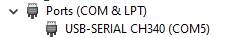
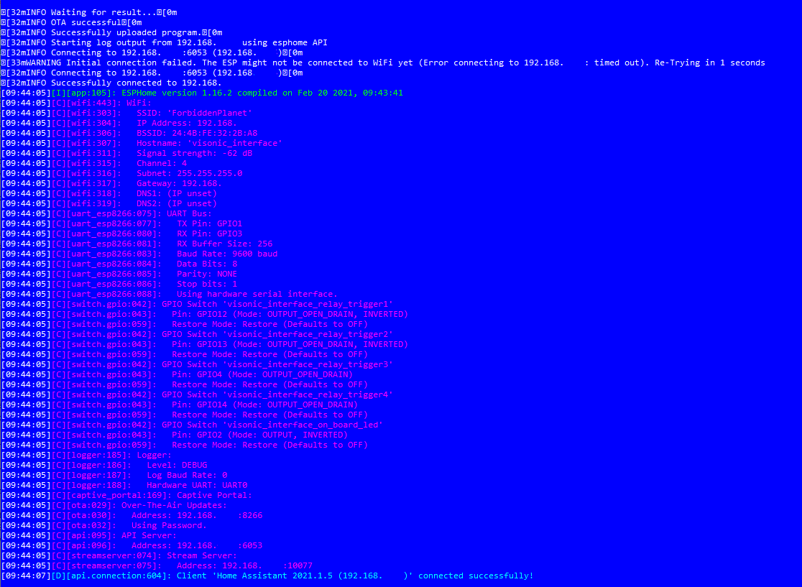

> **Language / Idioma:** **English** | [Leer en Español](https://github.com/ShaneGooseman/visonic/wiki/Using-Wemos-and-ESPHome-ES)

# Using Wemos D1 R2 and ESPHome (with Optional Siren Triggering)

This guide explains how to use a **Wemos D1 R2** (ESP8266) running **ESPHome** as a Wi-Fi TCP-to-serial bridge between a Visonic PowerMax/PowerMaster panel and Home Assistant, with optional relay support to trigger the panel siren via a wired zone input.

> **Disclaimer:** Modifying alarm hardware is at your own risk and may void your Visonic warranty. Never power the Wemos from USB and the 12 V barrel connector simultaneously.

## Hardware Required
- Supported Visonic PowerMax/PowerMaster panel ([Supported Panels](https://github.com/ShaneGooseman/visonic/wiki#supported-visonic-panels))
- Wemos D1 R2 (ESP8266 with onboard Wi-Fi, UART, and 9–14 V DC barrel input)
- 5.5 mm × 2.1 mm DC barrel power lead and jumper wires
- *Optional (siren triggering):* 5 V DC relay module (single or dual) + 2× or 4× 2.2 kΩ resistors

## ESPHome Configuration Template
Instead of external ZIP archives, the maintained YAML template is included directly in this repository:
- [`custom_components/visonic/examples/esphome/visonic_esphome_wemos_d1_r2_siren.yaml`](https://github.com/ShaneGooseman/visonic/blob/master/custom_components/visonic/examples/esphome/visonic_esphome_wemos_d1_r2_siren.yaml)
- *(For newer ESP32 boards, see [`visonic_esphome_esp32_serial_bridge.yaml`](https://github.com/ShaneGooseman/visonic/blob/master/custom_components/visonic/examples/esphome/visonic_esphome_esp32_serial_bridge.yaml).)*

Create or update your ESPHome `secrets.yaml` with your Wi-Fi credentials, static IP, TCP port (e.g., `10077`), panel baud rate (`9600` or `38400`), and API/OTA password.

## Flashing ESPHome
1. Connect the Wemos D1 R2 via USB to your PC and ensure the CH340G serial driver is installed (Windows Device Manager → *Ports (COM & LPT)*):
   
2. Either use the **ESPHome Dashboard** in Home Assistant (*New Device → ESP8266 → Skip → Edit → paste YAML → Install*), or run from CLI:
   ```bash
   pip install -U esphome
   python -m esphome run visonic_esphome_wemos_d1_r2_siren.yaml
   ```
   
3. After the initial USB flash, future updates can be pushed Over-The-Air (OTA).

## Relays & Siren Services (Optional)
The template exposes 4 relay switches (`D6`/`D7` active-low, `D2`/`D5` active-high) and 2 Home Assistant services (`esphome.visonic_interface_trigger_siren1` and `trigger_siren2`) that pulse the relay for 5 seconds. Wire the relay's **Common (COM)** and **Normally Closed (NC)** terminals with two 2.2 kΩ EOL resistors to a wired panel zone so the relay remains de-energized during normal operation. If your relay board has an opto-coupler jumper, remove it.

## Installing in the Panel & Adding to Home Assistant
1. **Power:** Tap 12 V DC from the panel's internal power block (do **not** draw Wemos power from the PC/IP serial pins). If using an external USB power supply, share **GND** with the panel.
2. **Serial:** Connect Wemos `TX` → Panel `RX`, and Wemos `RX` → Panel `TX` on the PC/IP or PRG/PPA header.
3. **Home Assistant:**
   - Add the **ESPHome** device if using the relay/LED entities.
   - Add the **Visonic Intruder Alarm** integration with connection type **Ethernet**, using the Wemos static IP and configured TCP port.

---

*Original integration and documentation by [@davesmeghead](https://github.com/davesmeghead/visonic). Maintained and updated in this fork by [@ShaneGooseman](https://github.com/ShaneGooseman/visonic).*
